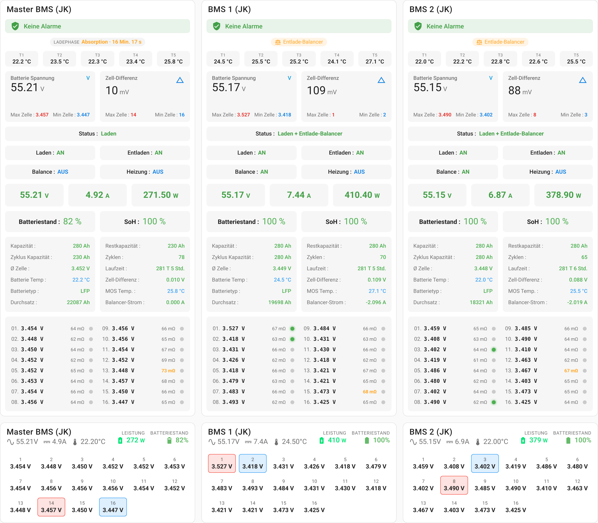

<p align="center"></p>

# JK-BMS RS485 add-on for Home Assistant (fork Xander2980)

Home Assistant add-on that reads **JK-BMS** battery management systems (JK-PB / "JK02_32S" protocol) over
**RS485** — USB adapter or RS485-to-Ethernet/Wi-Fi gateway — or **CAN bus**, and publishes everything to
Home Assistant through **MQTT Discovery**.

This is a fork of the [SmartPhoton JK-BMS add-on](https://github.com/jean-luc1203/jkbms-rs485-addon) by
Jean-Luc Martinelli. It keeps the proven Node-RED engine and adds:

- **Decoder fixes** checked byte by byte against [syssi/esphome-jk-bms](https://github.com/syssi/esphome-jk-bms)
- **More values** that the BMS already sends but were not decoded
- **English code**, and entity names in **German, English or French**
- The **JK-BMS card** for Home Assistant instead of the Premium dashboards (see below)
- The Issue #166 corrections built in (they were missing in upstream 4.1.14)

No Premium licence, no licence server, no telemetry needed.

---

## Installation

Open directly in Home Assistant:

[](https://my.home-assistant.io/redirect/supervisor_add_addon_repository/?repository_url=https%3A%2F%2Fgithub.com%2FXander2980%2Fjkbms-rs485-addon)

Or by hand:

1. Home Assistant → **Settings → Add-ons → Add-on Store → ⋮ → Repositories**
2. Add `https://github.com/Xander2980/jkbms-rs485-addon`
3. Install **JK-BMS wired management (fork Xander2980)**
4. Fill in the options (see below) and start the add-on

> Coming from the upstream add-on: stop it first. Both use `/config/smartphoton_jkbms` and the same
> MQTT discovery ids, so the existing entities, history and dashboards are taken over unchanged.
> Make a backup before switching.

Docker without Home Assistant OS: see [standalone/README.md](standalone/README.md).

## Options

| Option | Description | Example |
|---|---|---|
| `jkbms_path` | USB serial port (Settings → System → Hardware → All hardware, `ttyUSB…`) | `/dev/serial/by-id/usb-1a86_USB_Serial-if00-port0` |
| `jkbms_count` | Number of BMS (1–15) | `3` |
| `use_gateway` | Use an RS485 TCP gateway instead of USB | `true` |
| `gateway_ip_port` | Gateway address and port | `192.168.1.100:5000` |
| `bms_broadcasting` | `true`: a JK-BMS is the RS485 master, the add-on only listens. `false`: the add-on polls every BMS (settings can be changed) | `true` |
| `non_broadcasting_data_interval_s` | Polling interval without broadcasting (1–30 s) | `3` |
| `CAN_bus_usage` | Read the BMS via CAN bus | `false` |
| `mqttadresse_port`, `mqttuser`, `mqttpass` | MQTT broker | `core-mosquitto:1883` |
| `dashboard_language` | Language of the entity names and of the built-in dashboard: `de`, `en`, `fr` | `de` |
| `create_dashboard` | Create the Home Assistant dashboard **JK-BMS** with the JK-BMS card | `false` |
| `communication_debug` | Detailed communication logs | `false` |
| `Send_bip` | Anonymous usage ping (system type only) to the upstream server smartphoton.ch at start and daily 15:00. Default off in the fork | `false` |

USB adapters: FTDI, CH340 and CP2102 work; adapters that show up as `ttyACM0` are not recommended.
Tested gateways: [images/Modbus-Gateway](images/Modbus-Gateway).

### Operating modes

- **Broadcast** (`bms_broadcasting: true`): one JK-BMS is the RS485 master (address 0000) and asks the
  others; the add-on listens. Read only — change settings in the JK app.
- **Active polling** (`bms_broadcasting: false`): the add-on is the RS485 master and polls each BMS.
  Settings can be written from Home Assistant where the BMS supports it.
- **CAN bus** (`CAN_bus_usage: true`): second RJ45 port of compatible JK-BMS.

---

## JK-BMS card

The dashboards come from the Lovelace card
**[bms-battery-cells-card-jkbms](https://github.com/Xander2980/bms-battery-cells-card-jkbms)**
(fork of the BMS Battery Cells Card by jayjojayson). One line of configuration per BMS:




```yaml
type: custom:bms-battery-cells-card-jkbms
jk_prefix: bms_master        # bms_master, bms_1, bms_2, ...
title: Master BMS
show_detailed_view: true
show_status: true
balance_led: true
```

With `jk_prefix` the card finds all cells, cell resistances and sensors of the add-on by itself:
voltage, signed power, current, SOC/SOH, alarms, charge phase, all five temperature sensors,
balancer status (charging / discharging balancer), balance current, charger plugged in, precharge,
heating, battery type and a banner while a protection release timer runs.

**Install the card:**

[](https://my.home-assistant.io/redirect/hacs_repository/?owner=Xander2980&repository=bms-battery-cells-card-jkbms&category=plugin)

or by hand: HACS → ⋮ → Custom repositories → `https://github.com/Xander2980/bms-battery-cells-card-jkbms`,
type *Dashboard* → install → reload the browser.

**Ready-made dashboard:** set the option `create_dashboard: true`. Two minutes after the start the add-on
creates the dashboard **JK-BMS** in the sidebar with one card per BMS it sees on the bus. The add-on owns
this dashboard and rewrites it on every start — build your own dashboard if you want to edit it.

---

## What the add-on publishes

Per BMS (`BMS_master`, `BMS_1`, …) about 150 entities, for example:

- **Live:** cell voltages and resistances, battery voltage, current, power (signed and unsigned), SOC, SOH,
  remaining/nominal capacity, cycles, MOSFET and 5 temperature sensors, balancing and balancer status,
  balance current, charge/discharge MOSFET, precharge, heating and heating current, charger plugged in,
  charge phase (bulk/absorption/float), protection release timers, emergency and smart-sleep countdown,
  PCL module, battery type, number of log entries, dry contacts
- **Settings:** all protection thresholds and delays, RCV/RFV, balancing, heating start/stop temperature,
  precharge time, smart sleep, display, float mode and further switches of register 0x1114
- **Device info:** model, firmware, serial number, uptime, power-on count
- **Alarms:** active alarms per BMS and a global alarm across all BMS

Entity ids follow `sensor.bms_<id>_bms_<key>`, e.g. `sensor.bms_1_bms_cell_7_volt`.
Durations are `duration` sensors in seconds. The display names follow `dashboard_language`.

Built-in Node-RED dashboard (live, device info, settings): `http://<home-assistant>:1891/dashboard`.

---

## Fixes compared to upstream 4.1.14

| Problem | Effect | Fixed |
|---|---|---|
| Balancer byte divided by 100 | "Balancing" never turned on | ✅ plus balancer status text |
| Byte 200 called `Switch_Balance` | it is the precharge flag | ✅ `Precharging`, old entity removed |
| Register 0x1114 bits shifted by one | smart sleep / PCL / timed stored data showed the wrong bit | ✅ |
| Writing smart sleep / PCL / timed stored data | cleared all other switches of 0x1114 (heating, display, float mode, RS485/CAN port) | ✅ read-modify-write |
| Battery type read from the wrong byte | never published | ✅ |
| Issue #166 corrections missing | phantom BMS devices from broken frames possible | ✅ built in |

Details: [CHANGELOG.md](CHANGELOG.md). Tests: `node --test tests/*.cjs` (CI: *Fork tests*).

---

## Safety

The add-on is for monitoring and automation. It must **not** be the only safety layer of a battery
installation: a failure of Home Assistant, MQTT or the RS485 link must never lead to an unsafe state.
See [SAFETY.md](SAFETY.md).

## Documentation

- [DOCS.md](DOCS.md) — add-on documentation (cable, alarms, MQTT)
- [Documentation/](Documentation) — RS485 and CAN protocol notes, diagnostics dashboard, cable assembly
- [FAQ.md](FAQ.md)

## Credits and licence

- Original add-on: **SmartPhoton JK-BMS** by Jean-Luc Martinelli (JLM) — <https://github.com/jean-luc1203/jkbms-rs485-addon>
- Protocol reference: [syssi/esphome-jk-bms](https://github.com/syssi/esphome-jk-bms)
- Card: fork of [jayjojayson/bms-battery-cells-card](https://github.com/jayjojayson/bms-battery-cells-card)

The community add-on is licensed under the **PolyForm Noncommercial License 1.0.0** (see [LICENSE](LICENSE)):
free for private, non-commercial use. This fork contains no Premium components.
